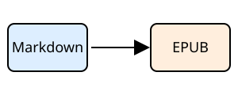
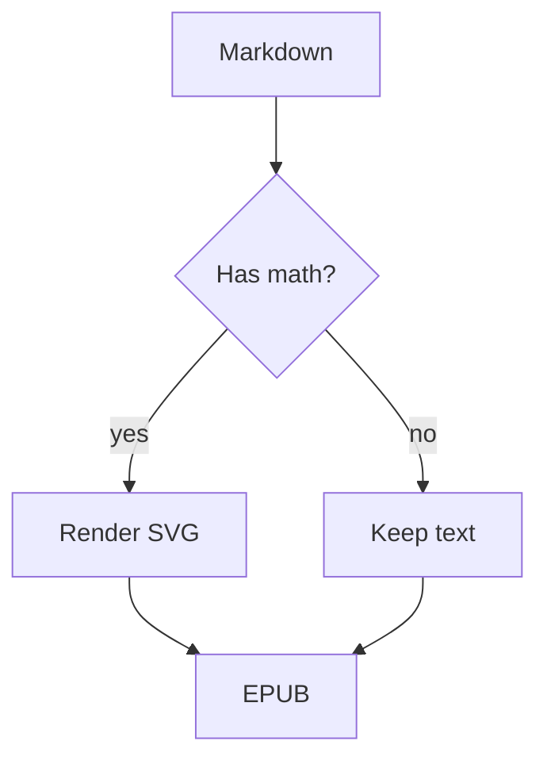

# Kitchen Sink

This fixture exercises every feature md2epub supports. It has *emphasis*,
**strong text**, ~~strikethrough~~, `inline code`, an autolink
https://example.org and a footnote reference.[^1] A non-breaking&nbsp;space
and an ampersand & a less-than sign < stay escaped.

## Tables

| Feature     | Status | Notes            |
|-------------|:------:|------------------|
| Tables      | yes    | GFM pipe syntax  |
| Footnotes   | yes    | See below        |
| Math        | yes    | `$...$` and `$$` |

## Task list

- [x] Write the fixture
- [ ] Render it on a Scribe
- [ ] Write in the margins

## Inline HTML

<div class="callout" style="border: 1px solid black; padding: 0.5em">
  <p>Raw <abbr title="HyperText Markup Language">HTML</abbr> passes through,
  including a line<br>break and <sup>super</sup>/<sub>sub</sub> scripts.</p>
</div>

An inline SVG:

<svg xmlns="http://www.w3.org/2000/svg" width="120" height="60" viewBox="0 0 120 60" aria-label="Inline shapes">
  <title>Inline shapes</title>
  <rect x="5" y="5" width="50" height="50" fill="#888"/>
  <circle cx="90" cy="30" r="25" fill="none" stroke="#000" stroke-width="3"/>
  <text x="30" y="35" font-size="12" text-anchor="middle">A</text>
</svg>

## Images

A referenced SVG with text:



A PNG chart and a JPEG photo:


A transparent PNG and a WebP:

 

A remote image (skipped with `--offline`):


## Code

```rust
fn main() {
    let greeting = "Hello, e-ink!";
    println!("{greeting}");
}
```

```python
def fib(n: int) -> int:
    return n if n < 2 else fib(n - 1) + fib(n - 2)
```

```
plain block without a language
```

## Math

Inline math such as $E = mc^2$ and $\alpha + \beta = \gamma$ sits on the
baseline. Display math:

$$
\sum_{i=0}^{n} i = \frac{n(n+1)}{2}
$$

$$
\begin{aligned}
f(x) &= (x+1)^2 \\
     &= x^2 + 2x + 1
\end{aligned}
$$

## Diagram



## Links

See the [tables section](#tables), the [HTML page](page.html) and its
[second section](page.html#second-section).

[^1]: Footnotes are collected at the end of the chapter.
